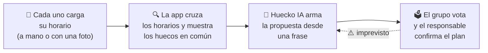
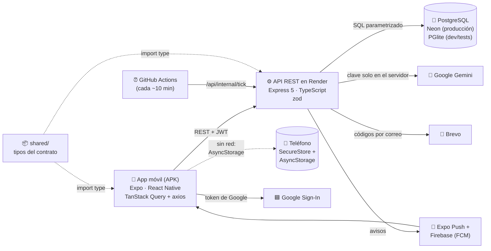

<div align="center">

# 🕒 HueckoApp

### Encuentra el hueco perfecto para juntarte con tu grupo ✨

*Cruza los horarios del grupo, propone planes con IA, vota, confirma y resuelve imprevistos, todo desde el celular.*

[](https://github.com/Alessandro-BS/HueckoApp-Android/actions/workflows/ci.yml)


[📲 Probar la v3.0.0](#-probar-la-v300-paso-a-paso) ·
[🎓 Requisitos del curso](#-requisitos-del-curso) ·
[🚀 Instalación desde el código](#-instalación-paso-a-paso) ·
[🧭 Cómo se usa](#-cómo-se-usa) ·
[🤖 Huecko IA](#-huecko-ia) ·
[🧰 Puesta en marcha](docs/puesta-en-marcha.md) ·
[🩺 Problemas comunes](#-solución-de-problemas) ·
[🗺️ Hoja de ruta](#️-hoja-de-ruta) ·
[📝 Cambios](CHANGELOG.md)

</div>

---

## 📌 ¿Qué es HueckoApp?

Coordinar a un grupo (amigos, compañeros de universidad o de trabajo) suele terminar en un chat interminable de «¿y tú cuándo puedes?». **HueckoApp** lo resuelve en cuatro pasos:



| | Función | Detalle |
|---|---|---|
| 📅 | **Horario semanal** | Bloques recurrentes o **puntuales** (un día concreto, que cuenta solo en su fecha) escritos a mano (reloj nativo de Android) o leídos de una foto con IA; se pueden **editar** y la app avisa si dos bloques se **solapan** |
| 👥 | **Grupos** | Código de invitación y roles: **varios organizadores** (nombran y quitan a otros organizadores), miembros y miembros **imprescindibles** |
| 🔍 | **Huecos en común** | El servidor cruza las agendas de 08:00 a 20:00 de la semana que elijas (hora de Lima) y muestra el % del grupo libre |
| 🗳️ | **Propuestas y votación** | Franjas con fecha (de 2 a 5, en la semana que elijas), fecha límite, lugar con tu ubicación, **voto múltiple** (puedes votar todas las franjas que te sirvan, o un voto por persona si quien propone lo prefiere), **cierre automático** al vencer el plazo (se confirma la franja más votada, o se cancela si nadie votó y quien gestiona puede **replantear** esa propuesta) y **replantear** la propuesta en votación (franjas y plazo nuevos) |
| ⚠️ | **Imprevistos** | Si alguien no puede ir, **decide el grupo** con una **votación exprés** (cancelar, reagendar o mantener) que cierra sola; si gana reagendar, quien gestiona el plan propone franjas nuevas y una fecha límite nueva |
| 🤖 | **Huecko IA** | Escaneo de horarios, borrador de plan desde una frase, ideas de plan y resumen de la votación |
| 🔔 | **Avisos push** | Notificaciones al celular (nueva propuesta, plan confirmado o cancelado, votación exprés y recordatorios); al tocarlas se abre Votar o el detalle del plan. Funcionan en el APK (no en Expo Go) y se apagan por celular en Perfil |
| 🔐 | **Cuentas seguras** | Registro con **código de 6 dígitos por correo** (Brevo), **verificación en dos pasos** opcional (se activa en Perfil), **recuperar la contraseña** desde el login y **Continuar con Google** (en el APK, no en Expo Go). Sin código no hay sesión. Configuración en la [guía de puesta en marcha](docs/puesta-en-marcha.md) |
| 📡 | **Unirse acercando el celular** | Quien invita y quien se une juntan los celulares pantalla con pantalla: el sensor de proximidad de los dos detecta el contacto, el giroscopio confirma que están quietos y el servidor los empareja por la hora |
| 💾 | **Funciona sin conexión** | Recuerda tu sesión y muestra la última copia de Inicio si no hay red |
| 🛡️ | **Administración** | Estadísticas, gráficos, informes PDF/CSV, usuarios, grupos y registro de acciones |

---

## 🎓 Requisitos del curso

Cada requisito, para qué lo usa la app, dónde está en el código y **cómo mostrarlo en vivo**. Las demostraciones de la tercera entrega se hacen con el **APK** (ver [📲 Probar la v3.0.0](#-probar-la-v300-paso-a-paso)).

### 🎓 Tercera entrega (v3.0.0)

| Requisito | ¿Para qué lo usa la app? | Dónde está | 🎬 Cómo mostrarlo |
|---|---|---|---|
| 🌐 **Retrofit** (equivalente en React Native) | Hablar con la API REST con un cliente tipado | **axios**: instancia con URL base e interceptores (token y errores) en [`client.ts`](mobile/src/api/client.ts) y una función tipada por endpoint en [`src/api/`](mobile/src/api/), como una interfaz de Retrofit | Mostrar `client.ts` y, por ejemplo, [`groups.ts`](mobile/src/api/groups.ts): cada función es un endpoint |
| 🌐 **Volley** (equivalente en React Native) | Cola de peticiones, caché y **reintentos** cuando el servidor tarda en despertar | **TanStack Query** (`@tanstack/react-query`) en [`queryClient.ts`](mobile/src/api/queryClient.ts) y [`useApiQuery`](mobile/src/hooks/useApiQuery.ts), usado en Inicio, Grupos, Planes y Disponibilidad. Sin respuesta o con un 5xx reintenta 3 veces (2 s, 4 s, 8 s) | Abrir la app con Render dormido (más de 15 min sin uso): Inicio muestra «cargando» unos segundos y luego los datos, **sin error**, porque reintenta solo. Al volver a un grupo, se pinta al instante desde la caché |
| 📷 **Cámara del dispositivo** | Fotografiar el horario para leerlo con Huecko IA | `launchCameraAsync` con su permiso en [`scheduleImage.ts`](mobile/src/utils/scheduleImage.ts) (`expo-image-picker`; permiso en [`app.json`](mobile/app.json)) | **Horario → Escanear → Cámara**, fotografiar un horario y revisar los bloques que leyó la IA |
| 📡 **Sensor de proximidad** | **Unirse a un grupo acercando el celular** (ver abajo) | `expo-sensors` no lo trae: **módulo nativo propio en Kotlin** (Expo Modules + `SensorManager`) en [`mobile/modules/proximity/`](mobile/modules/proximity/), usado por [`useProximity`](mobile/src/hooks/useProximity.ts) | Con dos celulares: uno en **Grupo → Agregar personas → Acercar para invitar**, el otro en **Grupos → Unirse acercando**; juntarlos pantalla con pantalla |
| 🌀 **Giroscopio** | Evitar falsos positivos: solo se une si los dos celulares están **quietos** al juntarse | `expo-sensors` (`Gyroscope`) en [`useStillness`](mobile/src/hooks/useStillness.ts) | Repetir la prueba anterior **moviendo** el celular: no dispara. Al dejarlo quieto, une |
| 🔔 **Notificaciones push** | Avisar de lo que pasa en el grupo aunque la app esté cerrada | `expo-notifications` + Firebase Cloud Messaging (registro en [`registration.ts`](mobile/src/notifications/registration.ts)); el servidor las envía por la Expo Push API ([`backend/src/notifications/`](backend/src/notifications/)) | Cerrar la app en un celular y crear una propuesta desde el otro: llega el aviso; al tocarlo se abre la votación |
| 📦 **APK instalable** | Instalar la app sin Expo Go, con el backend en internet | **EAS Build** ([`eas.json`](mobile/eas.json)) y backend en **Render** + **Neon** ([despliegue](docs/despliegue.md)) | Instalar el APK de [Releases](https://github.com/Alessandro-BS/HueckoApp-Android/releases/latest) en un celular con datos móviles (sin la PC) |
| 🧭 Magnetómetro (opcional) | — | ❌ No incluido | — |
| 💡 Sensor de luz (opcional) | — | ❌ No incluido | — |

**📡 Cómo funciona «unirse acercando el celular»**

El sensor de proximidad detecta que hay algo a ~5 cm de la pantalla, pero no **qué** celular es. Por eso los **dos** celulares lo usan y el servidor los empareja por la hora:

1. Quien invita abre **Agregar personas → Acercar para invitar**; quien se une abre **Unirse acercando**.
2. Juntan los celulares **pantalla con pantalla** (el sensor está arriba, junto al auricular).
3. Cada celular avisa al servidor del momento en que detectó algo cerca, solo si el giroscopio dice que está quieto.
4. Si llegan dos avisos casi a la vez (una invitación y una unión), el servidor une a esa persona al grupo y los dos vibran. Si hay coincidencias dudosas, no une a nadie y pide repetir o usar el código.

### 🎓 Segunda entrega (v2.0.0)

| Requisito | ¿Para qué lo usa la app? | Dónde está | 🎬 Cómo mostrarlo |
|---|---|---|---|
| 📍 **Geolocalización** | Poner el lugar del plan con tu ubicación actual, convertida en dirección | `expo-location` en [`useCurrentLocation.ts`](mobile/src/hooks/useCurrentLocation.ts) y [`usePlaceLookup.ts`](mobile/src/hooks/usePlaceLookup.ts); permiso en el plugin de [`app.json`](mobile/app.json) | **Crear propuesta → Usar mi ubicación actual**: rechaza el permiso (mensaje claro) y luego acéptalo (sale tu dirección y «Con coordenadas») |
| 🪝 **React Native (hooks)** | Toda la lógica de las pantallas vive en hooks reutilizables | 33 hooks propios en [`mobile/src/hooks/`](mobile/src/hooks/) más `AuthContext` en [`mobile/src/context/`](mobile/src/context/) | Mostrar en el código `useApiQuery` (leer con caché y reintentos), `useDashboard` y `useStillness` (giroscopio) |
| 🌐 **API REST** | La app habla con el backend Express por HTTP + JSON con token JWT | Cliente `axios` en [`mobile/src/api/`](mobile/src/api/); contrato completo en [`docs/api.md`](docs/api.md) | Abrir <https://hueckoapp-api.onrender.com/api/health> (o `http://localhost:3000/api/health` en local); en local, crear un bloque y ver la petición en la terminal del backend |
| 💾 **Async Storage** | Recordar el último correo, el perfil de la sesión y una copia de Inicio para abrir la app **sin red** | `@react-native-async-storage/async-storage` en [`appStorage.ts`](mobile/src/storage/appStorage.ts), usado por [`AuthContext.tsx`](mobile/src/context/AuthContext.tsx), [`LoginScreen.tsx`](mobile/src/screens/auth/LoginScreen.tsx) y [`useDashboard.ts`](mobile/src/hooks/useDashboard.ts) | 1) Cerrar sesión: el login trae el correo. 2) Apagar el backend y recargar la app: entra igual y Inicio muestra ☁️ «Sin conexión: estos son los últimos datos guardados.» |

<details>
<summary><b>🪝 Los 33 hooks propios, por tipo</b></summary>

| Tipo | Hooks |
|---|---|
| ♻️ Genéricos | `useApiQuery`, `useResource`, `useAction`, `useVoteToggle`, `useRefreshOnFocus`, `useRefreshErrorToast`, `usePagedList`, `useAppActive` |
| 🔐 Cuentas | `useChallengeCode`, `useResendCountdown` |
| 📅 Horario y grupos | `useSchedule`, `useGroups`, `useGroup`, `useAvailability`, `useDashboard` |
| 🗳️ Planes | `useProposals`, `useProposal` |
| 📡 Sensores | `useProximity`, `useProximityTrigger`, `useProximitySession`, `useStillness` |
| 📍 Ubicación | `useCurrentLocation`, `usePlaceLookup` |
| 🤖 IA | `useScheduleOcr`, `useProposalDraft`, `useAiSuggestions`, `useVotingSummary`, `useAiStatus` |
| 🛡️ Administración | `useAdminStats`, `useAdminReport`, `useAdminUser`, `useAdminGroup`, `useAdminLists` (usuarios, grupos y registro) |

</details>

<details>
<summary><b>💾 Qué se guarda en el teléfono y dónde (seguridad)</b></summary>

| Dato | Dónde | ¿Cifrado? | ¿Cuándo se borra? |
|---|---|---|---|
| 🔑 Token de sesión (JWT) | `expo-secure-store` (Keystore de Android) | ✅ Sí | Al cerrar sesión o si el servidor lo rechaza |
| 📧 Último correo usado | AsyncStorage | No (no es secreto) | Se conserva, para rellenar el login |
| 👤 Perfil de la sesión (nombre, correo y rol) | AsyncStorage | No | Al cerrar sesión |
| 🏠 Copia de Inicio (por usuario) | AsyncStorage | No | Al cerrar sesión |
| 🔔 Token de notificaciones de este celular | AsyncStorage | No (identifica el celular, no da acceso a la cuenta) | Al cerrar sesión |
| 🔔 Preferencia «Notificaciones en este celular» | AsyncStorage | No | Se conserva: es del celular, no de la cuenta |

- El token **nunca** pasa por AsyncStorage: un test lo comprueba.
- Una copia de otra versión de la app o con otra forma se ignora en vez de romper Inicio.
- El rol guardado solo sirve para dibujar el menú: el servidor revisa el rol en **cada** petición.

</details>

> 🎓 Además se aplican otros temas del curso: **seguridad** (JWT, bcrypt, códigos por correo, verificación en dos pasos, OAuth con Google, permisos en tiempo de ejecución, roles), **navegación** (`native-stack`, `bottom-tabs`, `drawer`, `material-top-tabs`), **cámara y galería** (`expo-image-picker`), **base de datos** (PostgreSQL) y **gráficos e informes** (`react-native-gifted-charts`, `expo-print`). Ver [Arquitectura](#️-arquitectura).

---

## 🆕 Novedades de la v3.0.0

| | Cambio |
|---|---|
| 📦 | **APK instalable** con EAS Build, y backend en internet (**Render** + base de datos **Neon**): ya no hace falta la PC ni la misma Wi-Fi |
| 🌐 | **TanStack Query** (equivalente de Volley): caché y reintentos automáticos cuando el servidor tarda en despertar |
| 📡 | **Unirse a un grupo acercando el celular**, con un módulo nativo propio (sensor de proximidad) y el **giroscopio** |
| 🔔 | **Notificaciones push** con la app cerrada, y recordatorio 1 h antes del plan |
| 🔐 | **Cuentas**: verificación del correo con un código, recuperar la contraseña, verificación en dos pasos y **Continuar con Google** |
| 📆 | **Franjas con fecha**, **voto múltiple**, **cierre automático** de la votación y **varios organizadores** por grupo |
| ⚠️ | **Votación exprés**: si falta alguien imprescindible, el grupo decide si cancelar, reagendar o mantener |
| 🌍 | [Página web y política de privacidad](https://alessandro-bs.github.io/HueckoApp-Android/) públicas |

Todos los cambios, en el [📝 CHANGELOG](CHANGELOG.md).

---

## 📲 Probar la v3.0.0 paso a paso

Hay tres formas de probar HueckoApp. **Para revisar la entrega, usa la A**: es la app real, con todas las funciones y sin instalar nada en la PC.

| | Forma | Qué necesitas | ¿Funciona todo? |
|---|---|---|---|
| 🅰️ | **[Instalar el APK](#️-a-instalar-el-apk-recomendado)** (recomendado) | Un celular Android con internet (dos para la proximidad) | ✅ Sí: Google, notificaciones, proximidad, IA y correos reales |
| 🅱️ | **[Expo Go con el backend en tu PC](#️-b-expo-go-con-el-backend-en-tu-pc)** | PC con Node 22 y el celular en la misma Wi-Fi | ⚠️ Sin Google, sin notificaciones y sin proximidad (Expo Go no trae ese código nativo) |
| 🆎 | **[Development build](#-c-development-build-funciones-nativas-con-tu-código)** | Lo de la B y una cuenta de Expo | ✅ Sí, cargando **tu** código: para desarrollar o depurar las funciones nativas |

### 🅰️ A. Instalar el APK (recomendado)

**¿Qué necesitas?**

| | Necesitas | Para qué |
|---|---|---|
| 📱 | Un celular **Android** con internet (Wi-Fi o datos) | La app habla con el servidor en internet, no con tu PC |
| 📱📱 | Un **segundo** celular Android (opcional) | Solo para probar **unirse acercando el celular**, que necesita dos teléfonos juntos |
| 📧 | Un **correo real** al que tengas acceso | Al registrarte llega un código de 6 dígitos que hay que escribir |
| 🟦 | Una cuenta de **Google** (opcional) | Para probar **Continuar con Google** |

**1️⃣ Descargar el APK**

En el celular, abre [**Releases → v3.0.0**](https://github.com/Alessandro-BS/HueckoApp-Android/releases/latest) y descarga el archivo `.apk` de la sección *Assets*.

> 💡 El APK no viene de Play Store porque es un proyecto de curso: se distribuye directo, como archivo.

**2️⃣ Instalarlo**

1. Abre el archivo descargado (desde la notificación de descarga o la app *Archivos*).
2. Android pedirá permitir **«Instalar apps desconocidas»** para el navegador o la app de archivos: actívalo. Es el permiso que Android exige para cualquier app que no venga de Play Store.
3. Si **Play Protect** muestra «App no verificada», toca **Más detalles → Instalar de todas formas**. Lo avisa porque la app no está publicada en la tienda, no porque haya encontrado un problema.
4. Si ya tenías una versión anterior de HueckoApp, **desinstálala primero**: la v3.0.0 cambió la forma de iniciar sesión y la anterior ya no sirve con el servidor nuevo.

**3️⃣ Primer arranque: el servidor despierta**

El backend está en el plan gratis de Render, que **duerme tras 15 minutos sin uso** y tarda **cerca de 1 minuto** en despertar. La primera vez que abras la app puede quedarse cargando unos segundos: **no es un error**, la app reintenta sola (eso es TanStack Query, el equivalente de Volley). Si quieres despertarlo antes, abre <https://hueckoapp-api.onrender.com/api/health> en el navegador hasta que diga `{"status":"ok"}`.

**4️⃣ Crear tu cuenta**

- **Con correo:** toca **Regístrate**, escribe nombre, correo y contraseña. Te llega un correo de **HueckoApp** con un código de 6 dígitos: escríbelo y entras.
  - 📬 Si no llega en un minuto, **revisa la carpeta Spam o Promociones**: el remitente es una cuenta de Gmail y algunos proveedores lo filtran.
  - ⏱️ El código vence en **15 minutos** y admite **5 intentos**. **Reenviar código** se activa tras 60 segundos.
- **Con Google:** toca **Continuar con Google** y elige tu cuenta. Entras sin contraseña ni código, porque Google ya verificó tu correo. Si el correo ya tenía una cuenta en HueckoApp, se vincula a ella.

> 🔐 ¿Por qué un código? Para que nadie pueda registrarse con un correo ajeno. **Sin código no hay sesión.**

**5️⃣ Permitir las notificaciones**

Al iniciar sesión, Android pide permiso para mostrar notificaciones: acéptalo. Puedes revisarlo en **☰ → Perfil → Notificaciones en este celular**.

**6️⃣ Recorrido de pruebas**

Con dos cuentas (en dos celulares, o cerrando sesión y entrando con la otra), recorre esta lista. La columna *¿Qué demuestra?* dice qué requisito o función se está probando.

| ☐ | Prueba | Qué hacer | Qué debería pasar | ¿Qué demuestra? |
|---|---|---|---|---|
| ☐ | 📷 Horario con la cámara | **Horario → Escanear → Cámara**, fotografía un horario | La IA lee los bloques; los revisas y tocas **Añadir a mi horario** | Cámara + Huecko IA |
| ☐ | 👥 Grupo con código | **Grupos → Crear grupo**; la otra cuenta usa **Unirme** con el código | Los dos aparecen en **Miembros** | API REST |
| ☐ | 📡 Unirse acercando | Celular A: **Grupo → Agregar personas → Acercar para invitar**. Celular B: **Grupos → Unirse acercando**. Junta las pantallas | B entra al grupo y **los dos vibran** | Sensor de proximidad (módulo nativo) |
| ☐ | 🌀 Giroscopio | Repite la prueba anterior **moviendo** un celular | No une mientras se mueve; al quedarse quietos, sí | Giroscopio |
| ☐ | 🔍 Huecos en común | Grupo → pestaña **Huecos**, cambia de semana | Franjas libres con el % del grupo disponible | Cruce de horarios en el servidor |
| ☐ | ✨ Propuesta con IA | **Planes → Crear propuesta**, escribe *«reunión de 2 horas el viernes en la tarde»* → **Rellenar con IA**; **Usar mi ubicación actual** | Franjas con fecha y el lugar con tu dirección | IA + geolocalización |
| ☐ | 🔔 Aviso con la app cerrada | Cierra la app en el celular B; crea la propuesta desde A | En B llega **«Nueva propuesta»**; al tocarla se abre **Votar** | Notificaciones push |
| ☐ | 🗳️ Voto múltiple y cierre | Vota varias franjas; deja que venza el plazo | Al vencer, se confirma sola la franja más votada (o se cancela si nadie votó) | Votación |
| ☐ | ⚠️ Votación exprés | Marca a alguien **imprescindible** en **Miembros**; esa persona reporta **Falta** en el plan | El grupo vota cancelar, reagendar o mantener, con la recomendación de la IA | Imprevistos |
| ☐ | 👑 Organizadores | **Miembros**: nombra organizador a otro e intenta quitárselo al último | Los dos pueden gestionar; al último no se le puede quitar | Roles |
| ☐ | 🔐 Verificación en dos pasos | **Perfil → Verificación en dos pasos** (pide tu contraseña y un código); cierra sesión y entra | Tras la contraseña pide un código nuevo del correo | Seguridad |
| ☐ | 🔑 Recuperar contraseña | En el login, **¿Olvidaste tu contraseña?** | Código por correo, contraseña nueva y entras; en el otro celular esa sesión se cierra | Seguridad |
| ☐ | 💾 Sin conexión | Activa el modo avión y abre la app | Entra con tu sesión e Inicio muestra ☁️ «Sin conexión» con la última copia | Async Storage |

> 🧪 El recorrido detallado, cuenta por cuenta, está en la [🧪 Guía de pruebas](docs/guia-de-pruebas.md).

### 🅱️ B. Expo Go con el backend en tu PC

Para ver el código funcionando en vivo sin compilar nada: el backend corre en tu PC (con su propia base local) y la app en **Expo Go**. Sigue la [🚀 Instalación desde el código](#-instalación-paso-a-paso).

Diferencias con el APK:

- ❌ **Continuar con Google**, las **notificaciones** y **unirse acercando** no aparecen: necesitan código nativo que Expo Go no trae (en su lugar, la app muestra «Usar el código»).
- 📧 Sin `BREVO_API_KEY` en `backend/.env`, los códigos de verificación **no se envían por correo**: salen en la **terminal del backend** (líneas `[correo] Asunto: Tu código de HueckoApp: 123456`). Las cuentas de ejemplo de la semilla ya están verificadas.
- 🔄 Usa su **propia base de datos** (PGlite en tu PC): las cuentas del APK no existen aquí, y al revés.

### 🆎 C. Development build: funciones nativas con tu código

Un *development build* es un APK que trae el código nativo (Google, notificaciones, proximidad) pero carga el JavaScript desde **Metro en tu PC**: cambias el código y lo ves al instante en el celular. Sirve para desarrollar o depurar esas funciones.

1. Ten lista la [instalación desde el código](#-instalación-paso-a-paso) (Node 22, `npm install`).
2. Inicia sesión en Expo (una vez por PC): desde `mobile/`, `npx eas-cli@latest login`.
3. Genera e instala el build: `npx eas-cli@latest build --profile development --platform android`. Al terminar, abre el enlace o QR de EAS en **cada** celular e instala el `.apk`.
4. Elige a qué backend se conecta, en `mobile/.env`:
   - **Render** (lo más simple, ya tiene todas las rutas): `EXPO_PUBLIC_API_URL=https://hueckoapp-api.onrender.com/api`
   - **Tu PC**: `EXPO_PUBLIC_API_URL=http://<IP-de-tu-PC>:3000/api`, con `npm run backend` encendido y los celulares en la misma Wi-Fi. Comprueba desde el navegador de cada celular que `http://<IP-de-tu-PC>:3000/api/health` dice `ok`.
5. En `mobile/`: `npx expo start --dev-client --clear` y abre la app instalada (no Expo Go) en cada celular.

> ⚠️ El APK de desarrollo está firmado con el mismo keystore de EAS que el de la entrega, así que Google y las notificaciones funcionan. Si compilas en local con `npx expo run:android` (firma de depuración), **no**: Google Cloud solo acepta la huella SHA-1 del keystore de EAS.

---

## 🏗️ Arquitectura



| Capa | Tecnología | Versión |
|---|---|---|
| 📱 App | Expo SDK · React Native · React · TypeScript | 57 · 0.86.3 · 19.2.3 · 6.0 |
| 🧭 Navegación | React Navigation (`native-stack`, `bottom-tabs`, `drawer`, `material-top-tabs`) | 7 |
| 🌐 Cliente HTTP | axios (≈ Retrofit) · TanStack Query (≈ Volley) | 1.20 · 5.105 |
| 📡 Sensores | Módulo nativo propio en Kotlin (proximidad) · `expo-sensors` (giroscopio) | — · 57 |
| 🔔 Notificaciones | `expo-notifications` + Firebase Cloud Messaging V1 | 57 |
| 🔐 Cuentas | `@react-native-google-signin/google-signin` (app) · `google-auth-library` (servidor) · Brevo (correo) | 17 · 11.3 · API v3 |
| ⚙️ API | Node.js · Express · zod · JWT · bcrypt | 22 · 5.2 · 4.6 |
| 🐘 Base de datos | PGlite (desarrollo y tests) · `pg` para Neon (producción) | 0.5 · 8.23 |
| 🤖 IA | Google Gemini con `@google/genai` | 2.24 |
| ☁️ Despliegue | EAS Build (APK) · Render (API) · Neon (PostgreSQL) · GitHub Pages (web) | — |
| 🧪 Tests | Vitest + Supertest (backend) · Jest + Testing Library (app) | — |

### 📁 Estructura del monorepo

```text
HueckoApp-Android/
├── 📱 mobile/            App Expo
│   ├── modules/proximity/ Módulo nativo en Kotlin: sensor de proximidad
│   ├── google-services.json  Firebase (identifica la app; no es secreto)
│   └── src/
│       ├── api/          Cliente axios (una función por endpoint) y TanStack Query
│       ├── auth/         Token en SecureStore y Google Sign-In
│       ├── components/   UI reutilizable (botones, tarjetas, campo de código, mapa OSM…)
│       ├── context/      AuthContext: sesión, token y perfil
│       ├── hooks/        33 hooks propios
│       ├── navigation/   Stack, drawer, barra inferior y pestañas
│       ├── notifications/ Registro del celular y navegación al tocar un aviso
│       ├── screens/      Pantallas por área (auth, dashboard, schedule, groups, proposals, profile, admin)
│       └── storage/      AsyncStorage (datos no secretos)
├── ⚙️ backend/           API REST Express
│   ├── src/              ai/ · auth/ · email/ · notifications/ · proximity/ · groups/ · proposals/ · schedule/ · admin/ · db/ …
│   └── test/             Tests con Vitest y Supertest
├── 📦 shared/            Tipos del contrato (@hueckoapp/shared)
├── 📜 docs/              API, guía de pruebas, despliegue y puesta en marcha
├── ⏰ .github/workflows/ CI y despertador del servidor
└── 🗃️ legacy-android/    v1.0.0 nativa en Kotlin (congelada)
```

> 💡 Es un **monorepo con npm workspaces**: un solo `npm install` en la raíz instala todo, con un único `package-lock.json`. El [contrato de la API](docs/api.md) es el acuerdo entre la app y el backend.

---

## ✅ Antes de empezar

> 💡 Esta sección y la siguiente son para **ejecutar el proyecto desde el código** (formas B y C). Para usar la app basta con el [APK](#️-a-instalar-el-apk-recomendado).

| | Necesitas | Nota |
|---|---|---|
| 🟢 | **Node.js 22** (22.13 o superior, **no 23 ni 24**) y npm | Obligatorio. Ver [¿Qué versión de Node?](#-qué-versión-de-node) |
| 🌿 | **Git** | Para clonar el repositorio |
| 📲 | **Expo Go** en tu celular Android (o un emulador de Android Studio) | [Play Store](https://play.google.com/store/apps/details?id=host.exp.exponent) |
| 📶 | **PC y celular en la misma red Wi-Fi** | El celular se conecta al backend de tu PC |
| 🔑 | **Clave de Gemini** (gratis) | Opcional: sin ella la IA funciona en *modo demostración* |
| 🐘 | Base de datos | **No hay que instalar nada**: se usa [PGlite](https://pglite.dev), PostgreSQL dentro del propio backend |

### 🟢 ¿Qué versión de Node?

El proyecto usa **Node 22**. Con Node 24, PGlite hace que Node se cierre de golpe (código `0xC0000409` en Windows) y los tests fallan al azar. Por eso [`.nvmrc`](.nvmrc) fija la versión, `engines` pide `>=22.13 <23` y [`.npmrc`](.npmrc) tiene `engine-strict=true`: con otra versión, `npm install` se detiene con `EBADENGINE`.

La forma más simple de tener Node 22 sin quitar otras versiones es **[fnm](https://github.com/Schniz/fnm)**:

<details open>
<summary><b>🪟 Windows</b></summary>

```powershell
winget install Schniz.fnm
# Agrega esta línea a tu perfil de PowerShell (notepad $PROFILE) y abre otra terminal:
fnm env --use-on-cd --shell powershell | Out-String | Invoke-Expression
```

</details>

<details>
<summary><b>🍎 macOS / 🐧 Linux</b></summary>

```bash
curl -fsSL https://fnm.vercel.app/install | bash
```

</details>

Después, en la carpeta del proyecto:

```bash
fnm install   # instala la versión de .nvmrc
fnm use       # la activa (con --use-on-cd se activa sola al entrar a la carpeta)
node -v       # debe decir v22.x
```

> 💡 Con **nvm** o **nvm-windows** también sirve: `nvm install 22` y `nvm use 22`.

---

## 🚀 Instalación paso a paso

### 1️⃣ Clonar e instalar (una sola vez)

```bash
git clone https://github.com/Alessandro-BS/HueckoApp-Android.git
cd HueckoApp-Android
fnm use
npm install
```

### 2️⃣ Configurar el backend

```bash
cp backend/.env.example backend/.env
```

Abre `backend/.env` y completa:

| Variable | Qué poner | ¿Obligatoria? |
|---|---|---|
| `JWT_SECRET` | Un valor largo y aleatorio. Genéralo con `node -e "console.log(require('crypto').randomBytes(48).toString('hex'))"` | ✅ Sí |
| `GEMINI_API_KEY` | Tu clave de <https://aistudio.google.com/apikey> | Recomendada (sin ella, «Modo demostración») |

> 🔒 `backend/.env` **nunca se sube al repositorio**. La clave de Gemini **nunca llega a la app**: solo la usa el servidor.
>
> 📧 En local no hace falta Brevo: sin `BREVO_API_KEY`, los códigos de verificación se escriben en la terminal del backend en vez de enviarse por correo.

### 3️⃣ Cargar datos de ejemplo (opcional)

```bash
npm run seed -w backend   # con el servidor detenido
```

Crea usuarios, grupos, horarios y dos planes con fechas relativas a hoy. Se puede repetir sin duplicar nada. Las cuentas de ejemplo ya tienen el **correo verificado**, así que entran sin código. La semilla crea cuentas con contraseña conocida (una de ellas administradora), por eso **se niega a correr contra una base remota** como la de producción, salvo que se pida a propósito con `-- --allow-remote`.

| 👤 Correo | 🔑 Contraseña | Qué tiene |
|---|---|---|
| `test@test.com` | `password123` | Organizador de «Proyecto Integrador» (código `PROY2026`) junto con Ana. Tiene un plan confirmado con un imprevisto de Ana |
| `ana@test.com` | `password123` | Organizadora de «Proyecto Integrador», con una votación abierta |
| `carlos@test.com` | `password123` | Único miembro de «Amigos de la Uni»: prueba **Unirme** con el código `HUECKO123` |
| `admin@test.com` | `password123` | 🛡️ Administrador: la app abre en Administración |

### 4️⃣ Levantar el backend (terminal 1)

```bash
npm run backend
```

✔️ Comprueba que responde: <http://localhost:3000/api/health> debe decir `{"status":"ok"}`.

### 5️⃣ Levantar la app (terminal 2)

```bash
cp mobile/.env.example mobile/.env
```

La app tiene que saber dónde está el backend. Se configura en `EXPO_PUBLIC_API_URL` de `mobile/.env`:

<details open>
<summary><b>📱 En tu celular con Expo Go (recomendado)</b></summary>

1. Conecta el celular a la **misma Wi-Fi** que tu PC (no uses datos móviles).
2. Busca la IP de tu PC:
   - **Windows:** `ipconfig` → «Dirección IPv4» del adaptador Wi-Fi o Ethernet (p. ej. `192.168.1.20`).
   - **macOS / Linux:** `ipconfig getifaddr en0` o `hostname -I`.
3. Pon esa IP en `mobile/.env`:
   ```bash
   EXPO_PUBLIC_API_URL=http://192.168.1.20:3000/api
   ```
4. Arranca la app y escanea el QR con **Expo Go**:
   ```bash
   npm run mobile
   ```
5. ✔️ Prueba desde el navegador del celular: `http://<IP-de-tu-PC>:3000/api/health` debe decir `ok`.

</details>

<details>
<summary><b>🖥️ En el emulador de Android Studio</b></summary>

1. Deja el valor por defecto de `mobile/.env`: `EXPO_PUBLIC_API_URL=http://10.0.2.2:3000/api` (dentro del emulador, `10.0.2.2` es tu PC).
2. Abre un emulador desde Android Studio (Device Manager), ejecuta `npm run mobile` y presiona **`a`**.

> ⚠️ El emulador consume mucha RAM. Con poca memoria va muy lento: en ese caso usa tu celular.

</details>

> 🔁 **¿Cambiaste `mobile/.env`?** Reinicia Expo limpiando la caché, porque las variables `EXPO_PUBLIC_*` se copian dentro de la app: `cd mobile` y `npx expo start --clear`.

🎉 **¡Listo!** Entra con una cuenta de ejemplo o crea la tuya desde **«Regístrate»**. Para un recorrido completo, sigue la [🧪 Guía de pruebas](docs/guia-de-pruebas.md).

---

## 🧭 Cómo se usa

**Moverse por la app:** abajo está la barra **🏠 Inicio · 📅 Horario · 👥 Grupos**. El botón **☰** (arriba a la izquierda) abre **Perfil** y **Cerrar sesión**.

| # | Paso | Cómo |
|---|---|---|
| 1️⃣ | 📝 **Entra** | Regístrate o inicia sesión. Al reabrir la app sigues dentro, incluso sin red |
| 2️⃣ | 📅 **Carga tu horario** | **Horario → Añadir bloque** (las horas se eligen con el reloj de Android) o **Escanear → Cámara / Galería**: la IA lee la foto, tú revisas y tocas **Añadir a mi horario** |
| 3️⃣ | 👥 **Arma el grupo** | **Grupos → Crear grupo** y comparte el código, o **Unirme** con un código |
| 4️⃣ | 🔍 **Mira los huecos** | En el grupo, pestaña **Huecos**: las franjas en las que el grupo está libre, por semana (elígela con el selector) |
| 5️⃣ | ✨ **Propón un plan con IA** | **Planes → Crear propuesta → Describe tu plan**: escribe *«reunión de 2 horas el viernes en la tarde»* y toca **Rellenar con IA**. Cada franja queda con su fecha: revisa, cambia la semana, el día o las horas si hace falta, y crea la propuesta |
| 6️⃣ | 📍 **Pon el lugar** | **Usar mi ubicación actual** o escríbelo a mano |
| 7️⃣ | 🗳️ **Vota y confirma** | Cada uno toca **Votar**. En **Ver detalles**, **Resumir votación** pide a la IA un resumen y el responsable toca **Confirmar plan** |
| 8️⃣ | ⚠️ **Resuelve imprevistos** | **Reportar imprevisto** en el plan. Un organizador puede marcar a alguien **imprescindible** en **Miembros**: si esa persona falta, el grupo **vota** (cancelar, reagendar o mantener) y la IA recomienda qué votar; si gana reagendar, quien gestiona el plan elige franjas nuevas con fecha (de 2 a 5) y un plazo nuevo |
| 9️⃣ | 🏠 **Sigue todo en Inicio** | Próximo plan, grupos, votaciones abiertas y avisos de imprevistos (con la votación exprés y cuánto falta para que cierre) |

> 📆 **Las franjas tienen fecha.** Al proponer eliges la semana (esta o hasta 3 más), el día y las horas, así que cada franja es un día concreto. No se pueden elegir días pasados ni franjas que ya empezaron, y al confirmar el plan se agenda en la fecha de la franja ganadora. Un horario puntual cuenta solo en su fecha. Si la franja que quieres confirmar ya empezó, la app te ofrece **Replantear** la propuesta.

---

## 🤖 Huecko IA

Google Gemini, llamado **solo desde el backend** ([`backend/src/ai/`](backend/src/ai/)).

| Función | Dónde en la app | Qué hace |
|---|---|---|
| 📷 **Escanear horario** | Horario → Escanear | Lee los bloques de una foto (las fotos grandes se reducen solas antes de subirse) |
| ✨ **Borrador de plan** | Crear propuesta → Rellenar con IA | De una frase saca título, categoría, lugar, fecha límite y **de 2 a 5 franjas con fecha** (de la semana elegida) recortadas a la duración y al momento pedidos |
| 💡 **Ideas de plan** | Planes → Ideas con IA | Hasta 3 ideas con lugar, franja y motivo, sin repetir planes recientes |
| 📋 **Resumen de votación** | Ver detalles → Resumir votación | Quién votó, qué franja va ganando y una recomendación: confirmar, reprogramar o cancelar |

**🛡️ Cómo se mantiene segura y fiable**

- 🔐 La clave nunca va en la app; el texto del usuario se envía **marcado como dato**, no como instrucciones.
- ✅ Cada respuesta se valida con zod. La IA elige franjas **por número** de una lista de huecos reales, y el servidor solo acepta horas que caben dentro de ese hueco: **nunca propone una hora en la que alguien está ocupado**.
- 🙋 La IA **solo sugiere**: confirmar un plan siempre lo decide una persona.
- ⏱️ Límite de 20 llamadas por usuario cada 15 minutos; si el modelo principal falla, se prueba uno de respaldo.

| Variable (`backend/.env`) | Por defecto | Para qué |
|---|---|---|
| `GEMINI_API_KEY` | vacía | Sin clave, respuestas de ejemplo y aviso «Modo demostración» |
| `GEMINI_MODEL` | `gemini-3.5-flash-lite` | Modelo principal (rápido, también para el escaneo) |
| `GEMINI_FALLBACK_MODEL` | `gemini-3.5-flash` | Respaldo si el principal está saturado, sin cuota o tarda demasiado |
| `GEMINI_THINKING_LEVEL` | `low` | Menos razonamiento = respuestas más rápidas |
| `GEMINI_TIMEOUT_MS` | `30000` | Tiempo máximo; después responde `503 AI_UNAVAILABLE` |
| `AI_RATE_LIMIT` | `20` | Llamadas por usuario cada 15 minutos |

---

## 🛡️ Administración

Una cuenta con rol `ADMIN` **solo administra**: la app abre en **Administración** y el menú ☰ tiene solo Administración, Perfil y Cerrar sesión.

| | Pestaña | Qué hace |
|---|---|---|
| 📊 | Estadísticas | Totales y gráficos de usuarios, grupos, planes y uso de la IA (por función, % de éxito y tiempo medio) |
| 📄 | Informes | Filtro por fechas y exportación a **PDF** y **CSV** |
| 👤 | Usuarios | Buscar, suspender o reactivar, dar o quitar el rol de administrador |
| 👥 | Grupos | Ver detalle, cancelar planes y eliminar grupos |
| 📜 | Registro | Historial de cada acción de administración |

🔑 **Nadie se hace administrador al registrarse ni desde la API.** El rol se da o se quita desde la consola del servidor, con el backend **detenido** (PGlite admite un solo proceso):

```bash
npm run make-admin -w backend -- correo@ejemplo.com            # ➕ dar el rol
npm run make-admin -w backend -- correo@ejemplo.com --revoke   # ➖ quitarlo
```

> 💡 Mientras tenga el rol, esa cuenta deja de ver Inicio, Horario y Grupos. Usa una cuenta aparte para administrar.

---

## ⚙️ Configuración

### `backend/.env` (copia de [`backend/.env.example`](backend/.env.example))

| Variable | Por defecto | Para qué |
|---|---|---|
| `PORT` | `3000` | Puerto de la API |
| `JWT_SECRET` | — | **Obligatoria.** Firma de los tokens |
| `JWT_EXPIRES_IN` | `7d` | Duración de la sesión |
| `DATABASE_URL` | vacía | Vacía = PGlite local. Con una URL de Neon, PostgreSQL en la nube ([despliegue](docs/despliegue.md)) |
| `PGLITE_DATA_DIR` | `./data/pglite` | Carpeta de la base local (se crea sola) |
| `TZ` | `America/Lima` | Zona horaria con la que se agendan los planes confirmados |
| `GEMINI_*`, `AI_RATE_LIMIT` | ver [Huecko IA](#-huecko-ia) | IA |
| `LOGIN_RATE_LIMIT` / `REGISTER_RATE_LIMIT` | `20` / `10` | Intentos por IP cada 15 min |
| `CODE_RATE_LIMIT` | `30` | Intentos por IP cada 15 min al verificar, reenviar código y «¿Olvidaste tu contraseña?» |
| `BREVO_API_KEY`, `BREVO_SENDER_EMAIL`, `BREVO_SENDER_NAME` | — / — / `HueckoApp` | Correos con el código. Sin clave, en desarrollo los códigos salen en el log del backend; en producción son obligatorias las dos primeras |
| `BREVO_DAILY_LIMIT` | `280` | Tope de correos cada 24 h entre todas las cuentas, por debajo de los 300/día del plan gratis de Brevo |
| `GOOGLE_WEB_CLIENT_ID` | vacía | ID de cliente Web de Google (no es secreto; el mismo de `extra.googleWebClientId` en [`app.json`](mobile/app.json)). Vacío = sin «Continuar con Google» |
| `CRON_SECRET` | vacía | Clave del despertador (`POST /api/internal/tick`, mínimo 32 caracteres). Vacía = esa ruta no existe |
| `EXPO_ACCESS_TOKEN` | vacía | Solo si activas «Enhanced Security» para los avisos en Expo |
| `TRUST_PROXY` | `false` | Proxies delante del servidor (solo en producción) |

> ☁️ En **producción** estas variables no están en un archivo: viven en el panel de **Render** ([`render.yaml`](render.yaml) solo declara sus nombres). Ver la [🧰 puesta en marcha](docs/puesta-en-marcha.md).

### `mobile/.env` (copia de [`mobile/.env.example`](mobile/.env.example))

| Variable | Por defecto | Para qué |
|---|---|---|
| `EXPO_PUBLIC_API_URL` | `http://10.0.2.2:3000/api` | Dirección del backend. En un celular: `http://<IP-de-tu-PC>:3000/api` |

> ⚠️ Todo lo que esté en `mobile/.env` termina dentro de la app: ahí solo van valores públicos.

---

## 🐘 Base de datos

En desarrollo, con `DATABASE_URL` vacía, el backend guarda todo en **PostgreSQL con PGlite** en `backend/data/pglite`. La carpeta se crea sola al arrancar, con todas las tablas (migraciones versionadas en [`migrations.ts`](backend/src/db/migrations.ts)).

- ⚠️ **PGlite admite un solo proceso:** detén el servidor antes de `seed` o `make-admin`.
- 🔄 **Empezar de cero:** detén el servidor y borra `backend/data/pglite`.
- ☁️ **Producción:** PostgreSQL en **Neon**, usado por el backend en **Render**. Al arrancar, el servidor aplica solo las migraciones pendientes. Detalles en [📜 despliegue](docs/despliegue.md) y en la [🧰 puesta en marcha](docs/puesta-en-marcha.md).

---

## 🧪 Calidad

| | Qué | Cómo |
|---|---|---|
| ✅ | **1848 tests** | 1068 del backend (Vitest + Supertest, cada test con su base PGlite en memoria) y 780 de la app (Jest + Testing Library) |
| 🔎 | **Tipos estrictos** | `npm run typecheck` en backend y app |
| 🤖 | **CI** | [GitHub Actions](.github/workflows/ci.yml) corre `npm ci`, `npm run typecheck` y `npm test` con Node 22 en cada PR y push a `develop` y `main` |
| 📱 | **Pruebas en celular** | Recorrido completo con la IA real en la [🧪 Guía de pruebas](docs/guia-de-pruebas.md) |

```bash
npm run typecheck
npm test
```

> 🕐 Los tests fijan solos `TZ=America/Lima`, así que pasan igual en cualquier PC o en la CI.

---

## 🧰 Comandos

| Comando (desde la raíz) | Para qué |
|---|---|
| `npm run backend` | ⚙️ API en <http://localhost:3000> (se recarga sola al cambiar el código) |
| `npm run mobile` | 📱 App con Expo |
| `npm test` | 🧪 Tests del backend y de la app |
| `npm run typecheck` | 🔎 Revisar tipos |
| `npm run seed -w backend` | 🌱 Datos de ejemplo (con el servidor detenido) |
| `npm run make-admin -w backend -- <correo> [--revoke]` | 🛡️ Dar o quitar el rol de administrador |
| `npm run build -w backend` | 🏗️ Compilar el backend a JavaScript |

Dentro de `mobile/`: `npx expo install <paquete>` para agregar librerías compatibles con el SDK (**no uses `npm install`** para librerías nativas) y `npx expo-doctor` para diagnosticar dependencias.

---

## 🩺 Solución de problemas

| Síntoma | Causa | Solución |
|---|---|---|
| `npm install` falla con `EBADENGINE` | No estás en Node 22 | `fnm use` y vuelve a intentar |
| Expo Go se queda cargando | El celular no llega a tu PC | Misma Wi-Fi; acepta el permiso de red de Node en el firewall de Windows o marca tu red como **Privada** |
| «No se pudo conectar con el servidor» al iniciar sesión | Backend apagado o IP equivocada en `mobile/.env` | Enciende el backend, revisa la IP y reinicia Expo con `npx expo start --clear` |
| La IA dice «Modo demostración» | Falta `GEMINI_API_KEY` o no reiniciaste el backend | Pon la clave en `backend/.env` y reinicia |
| «Demasiadas solicitudes» (`429`) | Límite de la IA: 20 llamadas cada 15 min por cuenta | Espera unos minutos |
| «La base local … está abierta por otro proceso» | `seed` o `make-admin` con el servidor encendido | Detén el servidor primero |
| «Esa franja ya empezó» al confirmar | La franja elegida ya empezó (las franjas tienen fecha) | Toca **Replantear** en la propuesta y elige franjas nuevas, o confirma una franja que aún no empiece |
| 📲 El APK se queda cargando al abrirlo | El servidor de Render estaba dormido (tarda ~1 min en despertar) | Espera: la app reintenta sola. O abre <https://hueckoapp-api.onrender.com/api/health> hasta que diga `ok` |
| 📬 No llega el código por correo | Filtro de spam, o se alcanzó un límite | Revisa **Spam / Promociones**; toca **Reenviar código** (tras 60 s). Hay un tope de 10 códigos por cuenta al día y de 280 en total al día («Hoy no podemos enviar más códigos») |
| 🟦 No aparece «Continuar con Google» | Estás en Expo Go, o el APK no trae el ID de cliente Web | Usa el APK o un development build (forma A o C) |
| 🟦 Error de Google al elegir la cuenta | El APK no está firmado con el keystore de EAS (su SHA-1 no está registrado en Google Cloud) | Instala el APK de Releases o un build de EAS, no uno compilado en local |
| 🔔 No llegan las notificaciones | Permiso denegado, Expo Go, o el interruptor de Perfil apagado | Usa el APK; en **Perfil** activa **Notificaciones en este celular** y revisa el permiso en los ajustes de Android |
| 📡 «Unirse acercando» no une | Los celulares se movían, no se juntaron a la vez, o hay varias parejas cerca | Junta las pantallas (el sensor está arriba, junto al auricular) y quédense quietos 1–2 s; si sigue fallando, usa el código |
| ❌ El APK anterior no puede registrar cuentas | La v3.0.0 cambió el registro (ahora pide un código) | Desinstala la versión anterior e instala la v3.0.0 |

---

## 🗺️ Hoja de ruta

| Versión | Estado | Qué incluye |
|---|---|---|
| 🏷️ **v1.0.0** | ✅ Publicada | App nativa en Kotlin + Jetpack Compose ([`legacy-android/`](legacy-android/)) |
| 🏷️ **v2.0.0** | ✅ Publicada | App Expo + backend Express + PostgreSQL + Huecko IA + administración + Async Storage |
| 🏷️ **v3.0.0** | ✅ Esta versión | **APK** con EAS Build, backend en Render + Neon, TanStack Query, unirse acercando el celular (proximidad + giroscopio), notificaciones push, cuentas con código por correo, 2FA y Google, franjas con fecha, votación exprés y varios organizadores. Configuración fuera del código: [🧰 puesta en marcha](docs/puesta-en-marcha.md) |
| 💡 Ideas | 🔜 Después | Gestión del grupo (expulsar, regenerar el código, QR), editar el perfil con foto, «Llegué» el día del plan, álbum del plan, reportes revisados por un administrador y actualización en tiempo real |

**🔜 Pendientes conocidos**

- 🧪 **Prueba completa en dos celulares** con el APK de la v3.0.0 (proximidad, notificaciones y Google), siguiendo el [recorrido de pruebas](#-probar-la-v300-paso-a-paso).
- 📧 Los correos salen desde una cuenta de Gmail (sin dominio propio), así que algunos proveedores los mandan a **Spam**. Con un dominio propio autenticado en Brevo (DKIM/DMARC) dejaría de pasar.
- ⏰ El despertador de GitHub Actions se desactiva solo tras **60 días** sin actividad en el repositorio: si pasa, actívalo de nuevo en **Actions → Despertador**.

- 🗺️ **«Elegir en el mapa» (en curso):** el mapa de OpenStreetMap ya funciona ([`OsmMap.tsx`](mobile/src/components/OsmMap.tsx)), pero el botón está desactivado (`features.mapPicker` en [`config.ts`](mobile/src/config.ts)) hasta tener un buscador con sugerencias mientras se escribe. El mapa de Google no se usa porque en Expo Go sale negro: Google rechaza la clave que trae Expo Go.
- 📆 La agenda de huecos va de **08:00 a 20:00**; un plan fuera de ese rango se agrega como franja a mano.

---

## 🌿 Flujo de trabajo (git flow)

| Rama | Uso |
|---|---|
| 🏷️ `main` | Solo versiones publicadas, cada una con su tag (`v1.0.0`, `v2.0.0`…) |
| 🔀 `develop` | Integración de las funciones terminadas |
| ✨ `feature/<nombre>` | Una función: sale de `develop` y vuelve por PR |
| 📦 `release/<versión>` | Preparar una versión: va por PR a `main` y vuelve a `develop` |
| 🚑 `hotfix/<nombre>` | Arreglo urgente: sale de `main` y vuelve a `main` y `develop` |

- 🚫 Nunca se hace commit directo en `main` ni en `develop`: todo entra por Pull Request.
- ✍️ Commits convencionales en español: `feat(mobile): …`, `fix(backend): …`, `docs: …`.
- ✅ Antes de abrir un PR: `npm run typecheck` y `npm test` en verde.

---

## 👥 Equipo

| Integrante |
|---|
| Marcela Natalie Rodriguez Munaylla |
| Fabrizio Alessandro Bustamante Soria |
| Fabrizio Adrián Medina Niño |

## 📜 Licencia

Proyecto académico del curso de Aplicaciones Móviles. El repositorio **no incluye un archivo `LICENSE`**: confirmen la licencia antes de reutilizar el código fuera del curso.

---

<div align="center">

*Desarrollado con gestión de requerimientos (REQM) y Scrum para asegurar la trazabilidad y la calidad del software.*

Hecho con 💜 para el curso de Aplicaciones Móviles

</div>
