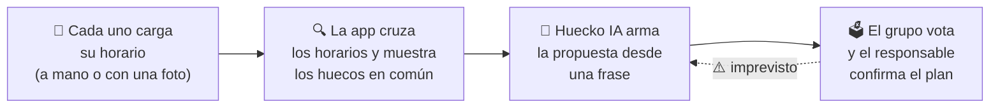
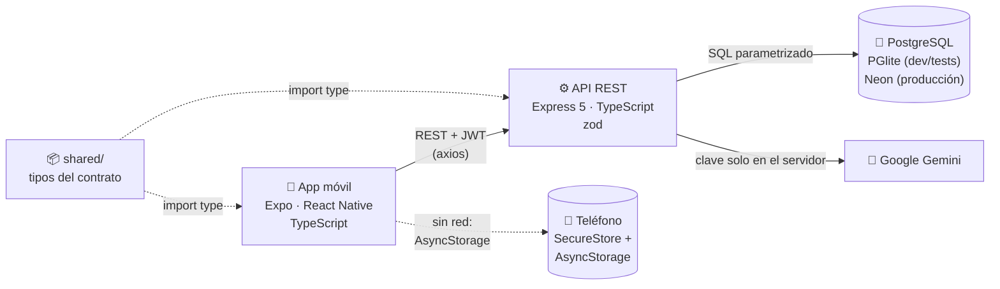

<div align="center">

# 🕒 HueckoApp

### Encuentra el hueco perfecto para juntarte con tu grupo ✨

*Cruza los horarios del grupo, propone planes con IA, vota, confirma y resuelve imprevistos, todo desde el celular.*

[](https://github.com/Alessandro-BS/HueckoApp-Android/actions/workflows/ci.yml)


[🎓 Requisitos de la entrega](#-requisitos-de-la-segunda-entrega) ·
[🚀 Instalación](#-instalación-paso-a-paso) ·
[🧭 Cómo se usa](#-cómo-se-usa) ·
[🤖 Huecko IA](#-huecko-ia) ·
[🩺 Problemas comunes](#-solución-de-problemas) ·
[🗺️ Hoja de ruta](#️-hoja-de-ruta) ·
[📝 Cambios](CHANGELOG.md)

</div>

---

## 📌 ¿Qué es HueckoApp?

Coordinar a un grupo (amigos, compañeros de universidad o de trabajo) suele terminar en un chat interminable de «¿y tú cuándo puedes?». **HueckoApp** lo resuelve en cuatro pasos:



| | Función | Detalle |
|---|---|---|
| 📅 | **Horario semanal** | Bloques escritos a mano (reloj nativo de Android) o leídos de una foto con IA |
| 👥 | **Grupos** | Código de invitación y roles: dueño, miembro y miembro **imprescindible** |
| 🔍 | **Huecos en común** | El servidor cruza las agendas de 08:00 a 20:00 y muestra el % del grupo libre |
| 🗳️ | **Propuestas y votación** | Franjas, fecha límite, lugar con tu ubicación, un voto por persona |
| ⚠️ | **Imprevistos** | Si alguien no puede ir, el responsable decide si el plan sigue o se reprograma |
| 🤖 | **Huecko IA** | Escaneo de horarios, borrador de plan desde una frase, ideas de plan y resumen de la votación |
| 💾 | **Funciona sin conexión** | Recuerda tu sesión y muestra la última copia de Inicio si no hay red |
| 🛡️ | **Administración** | Estadísticas, gráficos, informes PDF/CSV, usuarios, grupos y registro de acciones |

---

## 🎓 Requisitos de la segunda entrega

Los cuatro requisitos del curso, dónde están en el código y **cómo mostrarlos en vivo**:

| Requisito | ¿Para qué lo usa la app? | Dónde está | 🎬 Cómo mostrarlo |
|---|---|---|---|
| 📍 **Geolocalización** | Poner el lugar del plan con tu ubicación actual, convertida en dirección | `expo-location` en [`useCurrentLocation.ts`](mobile/src/hooks/useCurrentLocation.ts) y [`usePlaceLookup.ts`](mobile/src/hooks/usePlaceLookup.ts); permiso en el plugin de [`app.json`](mobile/app.json) | **Crear propuesta → Usar mi ubicación actual**: rechaza el permiso (mensaje claro) y luego acéptalo (sale tu dirección y «Con coordenadas») |
| 🪝 **React Native (hooks)** | Toda la lógica de las pantallas vive en hooks reutilizables | 25 hooks propios en [`mobile/src/hooks/`](mobile/src/hooks/) más `AuthContext` en [`mobile/src/context/`](mobile/src/context/) | Mostrar en el código `useResource` (cargar, refrescar y descartar respuestas tardías) y `useDashboard` |
| 🌐 **API REST** | La app habla con el backend Express por HTTP + JSON con token JWT | Cliente `axios` en [`mobile/src/api/`](mobile/src/api/); contrato completo en [`docs/api.md`](docs/api.md) | Crear un bloque o un grupo y ver la petición en la terminal del backend; abrir `http://localhost:3000/api/health` |
| 💾 **Async Storage** | Recordar el último correo, el perfil de la sesión y una copia de Inicio para abrir la app **sin red** | `@react-native-async-storage/async-storage` en [`appStorage.ts`](mobile/src/storage/appStorage.ts), usado por [`AuthContext.tsx`](mobile/src/context/AuthContext.tsx), [`LoginScreen.tsx`](mobile/src/screens/auth/LoginScreen.tsx) y [`useDashboard.ts`](mobile/src/hooks/useDashboard.ts) | 1) Cerrar sesión: el login trae el correo. 2) Apagar el backend y recargar la app: entra igual y Inicio muestra ☁️ «Sin conexión: estos son los últimos datos guardados.» |

<details>
<summary><b>🪝 Los 25 hooks propios, por tipo</b></summary>

| Tipo | Hooks |
|---|---|
| ♻️ Genéricos | `useResource`, `useAction`, `useVoteToggle`, `useRefreshOnFocus`, `useRefreshErrorToast`, `usePagedList` |
| 📅 Horario y grupos | `useSchedule`, `useGroups`, `useGroup`, `useAvailability`, `useDashboard` |
| 🗳️ Planes | `useProposals`, `useProposal` |
| 📍 Ubicación | `useCurrentLocation`, `usePlaceLookup` |
| 🤖 IA | `useScheduleOcr`, `useProposalDraft`, `useAiSuggestions`, `useVotingSummary`, `useAiStatus` |
| 🛡️ Administración | `useAdminStats`, `useAdminReport`, `useAdminUser`, `useAdminGroup`, `useAdminLists` (usuarios, grupos y registro) |

</details>

<details>
<summary><b>💾 Qué se guarda en el teléfono y dónde (seguridad)</b></summary>

| Dato | Dónde | ¿Cifrado? | ¿Cuándo se borra? |
|---|---|---|---|
| 🔑 Token de sesión (JWT) | `expo-secure-store` (Keystore de Android) | ✅ Sí | Al cerrar sesión o si el servidor lo rechaza |
| 📧 Último correo usado | AsyncStorage | No (no es secreto) | Se conserva, para rellenar el login |
| 👤 Perfil de la sesión (nombre, correo y rol) | AsyncStorage | No | Al cerrar sesión |
| 🏠 Copia de Inicio (por usuario) | AsyncStorage | No | Al cerrar sesión |

- El token **nunca** pasa por AsyncStorage: un test lo comprueba.
- Una copia de otra versión de la app o con otra forma se ignora en vez de romper Inicio.
- El rol guardado solo sirve para dibujar el menú: el servidor revisa el rol en **cada** petición.

</details>

> 🎓 Además se aplican otros temas del curso: **seguridad** (JWT, bcrypt, permisos en tiempo de ejecución, roles), **navegación** (`native-stack`, `bottom-tabs`, `drawer`, `material-top-tabs`), **cámara y galería** (`expo-image-picker`), **base de datos** (PostgreSQL) y **gráficos e informes** (`react-native-gifted-charts`, `expo-print`). Ver [Arquitectura](#️-arquitectura).

---

## 🆕 Novedades de la v2.0.0

| | Cambio |
|---|---|
| 📱 | App nueva en **Expo + React Native**, con backend propio en Express y PostgreSQL (la v1.0.0 nativa en Kotlin queda en [`legacy-android/`](legacy-android/)) |
| 💾 | **Async Storage**: correo recordado, sesión y copia de Inicio para abrir **sin red** |
| 🤖 | El borrador con IA respeta la **duración y el momento** pedidos y propone **hasta 3 franjas** para votar |
| 🛡️ | La cuenta administradora **solo administra**: abre en Administración, sin Inicio, Horario ni Grupos |
| 🗺️ | Mapa de **OpenStreetMap** listo para «Elegir en el mapa» (el botón queda *en curso*) |

Todos los cambios, en el [📝 CHANGELOG](CHANGELOG.md).

---

## 🏗️ Arquitectura



| Capa | Tecnología | Versión |
|---|---|---|
| 📱 App | Expo SDK · React Native · React · TypeScript | 57 · 0.86.3 · 19.2.3 · 6.0 |
| 🧭 Navegación | React Navigation (`native-stack`, `bottom-tabs`, `drawer`, `material-top-tabs`) | 7 |
| 🌐 Cliente HTTP | axios | 1.20 |
| ⚙️ API | Node.js · Express · zod · JWT · bcrypt | 22 · 5.2 · 4.6 |
| 🐘 Base de datos | PGlite (desarrollo y tests) · `pg` para Neon (producción) | 0.5 · 8.23 |
| 🤖 IA | Google Gemini con `@google/genai` | 2.24 |
| 🧪 Tests | Vitest + Supertest (backend) · Jest + Testing Library (app) | — |

### 📁 Estructura del monorepo

```text
HueckoApp-Android/
├── 📱 mobile/            App Expo
│   └── src/
│       ├── api/          Cliente axios, una función por endpoint
│       ├── components/   UI reutilizable (botones, tarjetas, mapa OSM…)
│       ├── context/      AuthContext: sesión, token y perfil
│       ├── hooks/        25 hooks propios
│       ├── navigation/   Stack, drawer, barra inferior y pestañas
│       ├── screens/      Pantallas por área (auth, dashboard, schedule, groups, proposals, admin)
│       └── storage/      AsyncStorage (datos no secretos)
├── ⚙️ backend/           API REST Express
│   ├── src/              ai/ · auth/ · availability/ · groups/ · proposals/ · schedule/ · admin/ · db/
│   └── test/             Tests con Vitest y Supertest
├── 📦 shared/            Tipos del contrato (@hueckoapp/shared)
├── 📜 docs/              Contrato de la API, guía de pruebas y despliegue
└── 🗃️ legacy-android/    v1.0.0 nativa en Kotlin (congelada)
```

> 💡 Es un **monorepo con npm workspaces**: un solo `npm install` en la raíz instala todo, con un único `package-lock.json`. El [contrato de la API](docs/api.md) es el acuerdo entre la app y el backend.

---

## ✅ Antes de empezar

| | Necesitas | Nota |
|---|---|---|
| 🟢 | **Node.js 22** (22.13 o superior, **no 23 ni 24**) y npm | Obligatorio. Ver [¿Qué versión de Node?](#-qué-versión-de-node) |
| 🌿 | **Git** | Para clonar el repositorio |
| 📲 | **Expo Go** en tu celular Android (o un emulador de Android Studio) | [Play Store](https://play.google.com/store/apps/details?id=host.exp.exponent) |
| 📶 | **PC y celular en la misma red Wi-Fi** | El celular se conecta al backend de tu PC |
| 🔑 | **Clave de Gemini** (gratis) | Opcional: sin ella la IA funciona en *modo demostración* |
| 🐘 | Base de datos | **No hay que instalar nada**: se usa [PGlite](https://pglite.dev), PostgreSQL dentro del propio backend |

### 🟢 ¿Qué versión de Node?

El proyecto usa **Node 22**. Con Node 24, PGlite hace que Node se cierre de golpe (código `0xC0000409` en Windows) y los tests fallan al azar. Por eso [`.nvmrc`](.nvmrc) fija la versión, `engines` pide `>=22.13 <23` y [`.npmrc`](.npmrc) tiene `engine-strict=true`: con otra versión, `npm install` se detiene con `EBADENGINE`.

La forma más simple de tener Node 22 sin quitar otras versiones es **[fnm](https://github.com/Schniz/fnm)**:

<details open>
<summary><b>🪟 Windows</b></summary>

```powershell
winget install Schniz.fnm
# Agrega esta línea a tu perfil de PowerShell (notepad $PROFILE) y abre otra terminal:
fnm env --use-on-cd --shell powershell | Out-String | Invoke-Expression
```

</details>

<details>
<summary><b>🍎 macOS / 🐧 Linux</b></summary>

```bash
curl -fsSL https://fnm.vercel.app/install | bash
```

</details>

Después, en la carpeta del proyecto:

```bash
fnm install   # instala la versión de .nvmrc
fnm use       # la activa (con --use-on-cd se activa sola al entrar a la carpeta)
node -v       # debe decir v22.x
```

> 💡 Con **nvm** o **nvm-windows** también sirve: `nvm install 22` y `nvm use 22`.

---

## 🚀 Instalación paso a paso

### 1️⃣ Clonar e instalar (una sola vez)

```bash
git clone https://github.com/Alessandro-BS/HueckoApp-Android.git
cd HueckoApp-Android
fnm use
npm install
```

### 2️⃣ Configurar el backend

```bash
cp backend/.env.example backend/.env
```

Abre `backend/.env` y completa:

| Variable | Qué poner | ¿Obligatoria? |
|---|---|---|
| `JWT_SECRET` | Un valor largo y aleatorio. Genéralo con `node -e "console.log(require('crypto').randomBytes(48).toString('hex'))"` | ✅ Sí |
| `GEMINI_API_KEY` | Tu clave de <https://aistudio.google.com/apikey> | Recomendada (sin ella, «Modo demostración») |

> 🔒 `backend/.env` **nunca se sube al repositorio**. La clave de Gemini **nunca llega a la app**: solo la usa el servidor.

### 3️⃣ Cargar datos de ejemplo (opcional)

```bash
npm run seed -w backend   # con el servidor detenido
```

Crea usuarios, grupos, horarios y dos planes con fechas relativas a hoy. Se puede repetir sin duplicar nada.

| 👤 Correo | 🔑 Contraseña | Qué tiene |
|---|---|---|
| `test@test.com` | `password123` | Dueño de «Proyecto Integrador» (código `PROY2026`) con Ana. Tiene un plan confirmado con un imprevisto de Ana |
| `ana@test.com` | `password123` | Miembro de «Proyecto Integrador», con una votación abierta |
| `carlos@test.com` | `password123` | Único miembro de «Amigos de la Uni»: prueba **Unirme** con el código `HUECKO123` |
| `admin@test.com` | `password123` | 🛡️ Administrador: la app abre en Administración |

### 4️⃣ Levantar el backend (terminal 1)

```bash
npm run backend
```

✔️ Comprueba que responde: <http://localhost:3000/api/health> debe decir `{"status":"ok"}`.

### 5️⃣ Levantar la app (terminal 2)

```bash
cp mobile/.env.example mobile/.env
```

La app tiene que saber dónde está el backend. Se configura en `EXPO_PUBLIC_API_URL` de `mobile/.env`:

<details open>
<summary><b>📱 En tu celular con Expo Go (recomendado)</b></summary>

1. Conecta el celular a la **misma Wi-Fi** que tu PC (no uses datos móviles).
2. Busca la IP de tu PC:
   - **Windows:** `ipconfig` → «Dirección IPv4» del adaptador Wi-Fi o Ethernet (p. ej. `192.168.1.20`).
   - **macOS / Linux:** `ipconfig getifaddr en0` o `hostname -I`.
3. Pon esa IP en `mobile/.env`:
   ```bash
   EXPO_PUBLIC_API_URL=http://192.168.1.20:3000/api
   ```
4. Arranca la app y escanea el QR con **Expo Go**:
   ```bash
   npm run mobile
   ```
5. ✔️ Prueba desde el navegador del celular: `http://<IP-de-tu-PC>:3000/api/health` debe decir `ok`.

</details>

<details>
<summary><b>🖥️ En el emulador de Android Studio</b></summary>

1. Deja el valor por defecto de `mobile/.env`: `EXPO_PUBLIC_API_URL=http://10.0.2.2:3000/api` (dentro del emulador, `10.0.2.2` es tu PC).
2. Abre un emulador desde Android Studio (Device Manager), ejecuta `npm run mobile` y presiona **`a`**.

> ⚠️ El emulador consume mucha RAM. Con poca memoria va muy lento: en ese caso usa tu celular.

</details>

> 🔁 **¿Cambiaste `mobile/.env`?** Reinicia Expo limpiando la caché, porque las variables `EXPO_PUBLIC_*` se copian dentro de la app: `cd mobile` y `npx expo start --clear`.

🎉 **¡Listo!** Entra con una cuenta de ejemplo o crea la tuya desde **«Regístrate»**. Para un recorrido completo, sigue la [🧪 Guía de pruebas](docs/guia-de-pruebas.md).

---

## 🧭 Cómo se usa

**Moverse por la app:** abajo está la barra **🏠 Inicio · 📅 Horario · 👥 Grupos**. El botón **☰** (arriba a la izquierda) abre **Perfil** y **Cerrar sesión**.

| # | Paso | Cómo |
|---|---|---|
| 1️⃣ | 📝 **Entra** | Regístrate o inicia sesión. Al reabrir la app sigues dentro, incluso sin red |
| 2️⃣ | 📅 **Carga tu horario** | **Horario → Añadir bloque** (las horas se eligen con el reloj de Android) o **Escanear → Cámara / Galería**: la IA lee la foto, tú revisas y tocas **Añadir a mi horario** |
| 3️⃣ | 👥 **Arma el grupo** | **Grupos → Crear grupo** y comparte el código, o **Unirme** con un código |
| 4️⃣ | 🔍 **Mira los huecos** | En el grupo, pestaña **Huecos**: las franjas en las que el grupo está libre |
| 5️⃣ | ✨ **Propón un plan con IA** | **Planes → Crear propuesta → Describe tu plan**: escribe *«reunión de 2 horas el viernes en la tarde»* y toca **Rellenar con IA**. Revisa las franjas y crea la propuesta |
| 6️⃣ | 📍 **Pon el lugar** | **Usar mi ubicación actual** o escríbelo a mano |
| 7️⃣ | 🗳️ **Vota y confirma** | Cada uno toca **Votar**. En **Ver detalles**, **Resumir votación** pide a la IA un resumen y el responsable toca **Confirmar plan** |
| 8️⃣ | ⚠️ **Resuelve imprevistos** | **Reportar imprevisto** en el plan. El dueño puede marcar a alguien **imprescindible** en **Miembros**: si esa persona falta, el plan se reprograma |
| 9️⃣ | 🏠 **Sigue todo en Inicio** | Próximo plan, grupos, votaciones abiertas y avisos de imprevistos |

> 📆 **Las franjas son de una semana tipo.** «Vie 15:00–17:00» significa *el próximo viernes*: al confirmar, el plan se agenda en la próxima vez que ocurre esa franja. Confirma **antes** de que empiece para que sea esta semana.

---

## 🤖 Huecko IA

Google Gemini, llamado **solo desde el backend** ([`backend/src/ai/`](backend/src/ai/)).

| Función | Dónde en la app | Qué hace |
|---|---|---|
| 📷 **Escanear horario** | Horario → Escanear | Lee los bloques de una foto (las fotos grandes se reducen solas antes de subirse) |
| ✨ **Borrador de plan** | Crear propuesta → Rellenar con IA | De una frase saca título, categoría, lugar, fecha límite y **hasta 3 franjas** recortadas a la duración y al momento pedidos |
| 💡 **Ideas de plan** | Planes → Ideas con IA | Hasta 3 ideas con lugar, franja y motivo, sin repetir planes recientes |
| 📋 **Resumen de votación** | Ver detalles → Resumir votación | Quién votó, qué franja va ganando y una recomendación: confirmar, reprogramar o cancelar |

**🛡️ Cómo se mantiene segura y fiable**

- 🔐 La clave nunca va en la app; el texto del usuario se envía **marcado como dato**, no como instrucciones.
- ✅ Cada respuesta se valida con zod. La IA elige franjas **por número** de una lista de huecos reales, y el servidor solo acepta horas que caben dentro de ese hueco: **nunca propone una hora en la que alguien está ocupado**.
- 🙋 La IA **solo sugiere**: confirmar un plan siempre lo decide una persona.
- ⏱️ Límite de 20 llamadas por usuario cada 15 minutos; si el modelo principal falla, se prueba uno de respaldo.

| Variable (`backend/.env`) | Por defecto | Para qué |
|---|---|---|
| `GEMINI_API_KEY` | vacía | Sin clave, respuestas de ejemplo y aviso «Modo demostración» |
| `GEMINI_MODEL` | `gemini-3.5-flash-lite` | Modelo principal (rápido, también para el escaneo) |
| `GEMINI_FALLBACK_MODEL` | `gemini-3.5-flash` | Respaldo si el principal está saturado, sin cuota o tarda demasiado |
| `GEMINI_THINKING_LEVEL` | `low` | Menos razonamiento = respuestas más rápidas |
| `GEMINI_TIMEOUT_MS` | `30000` | Tiempo máximo; después responde `503 AI_UNAVAILABLE` |
| `AI_RATE_LIMIT` | `20` | Llamadas por usuario cada 15 minutos |

---

## 🛡️ Administración

Una cuenta con rol `ADMIN` **solo administra**: la app abre en **Administración** y el menú ☰ tiene solo Administración, Perfil y Cerrar sesión.

| | Pestaña | Qué hace |
|---|---|---|
| 📊 | Estadísticas | Totales y gráficos de usuarios, grupos, planes y uso de la IA (por función, % de éxito y tiempo medio) |
| 📄 | Informes | Filtro por fechas y exportación a **PDF** y **CSV** |
| 👤 | Usuarios | Buscar, suspender o reactivar, dar o quitar el rol de administrador |
| 👥 | Grupos | Ver detalle, cancelar planes y eliminar grupos |
| 📜 | Registro | Historial de cada acción de administración |

🔑 **Nadie se hace administrador al registrarse ni desde la API.** El rol se da o se quita desde la consola del servidor, con el backend **detenido** (PGlite admite un solo proceso):

```bash
npm run make-admin -w backend -- correo@ejemplo.com            # ➕ dar el rol
npm run make-admin -w backend -- correo@ejemplo.com --revoke   # ➖ quitarlo
```

> 💡 Mientras tenga el rol, esa cuenta deja de ver Inicio, Horario y Grupos. Usa una cuenta aparte para administrar.

---

## ⚙️ Configuración

### `backend/.env` (copia de [`backend/.env.example`](backend/.env.example))

| Variable | Por defecto | Para qué |
|---|---|---|
| `PORT` | `3000` | Puerto de la API |
| `JWT_SECRET` | — | **Obligatoria.** Firma de los tokens |
| `JWT_EXPIRES_IN` | `7d` | Duración de la sesión |
| `DATABASE_URL` | vacía | Vacía = PGlite local. Con una URL de Neon, PostgreSQL en la nube ([despliegue](docs/despliegue.md)) |
| `PGLITE_DATA_DIR` | `./data/pglite` | Carpeta de la base local (se crea sola) |
| `TZ` | `America/Lima` | Zona horaria con la que se agendan los planes confirmados |
| `GEMINI_*`, `AI_RATE_LIMIT` | ver [Huecko IA](#-huecko-ia) | IA |
| `LOGIN_RATE_LIMIT` / `REGISTER_RATE_LIMIT` | `20` / `10` | Intentos por IP cada 15 min |
| `TRUST_PROXY` | `false` | Proxies delante del servidor (solo en producción) |

### `mobile/.env` (copia de [`mobile/.env.example`](mobile/.env.example))

| Variable | Por defecto | Para qué |
|---|---|---|
| `EXPO_PUBLIC_API_URL` | `http://10.0.2.2:3000/api` | Dirección del backend. En un celular: `http://<IP-de-tu-PC>:3000/api` |

> ⚠️ Todo lo que esté en `mobile/.env` termina dentro de la app: ahí solo van valores públicos.

---

## 🐘 Base de datos

En desarrollo, con `DATABASE_URL` vacía, el backend guarda todo en **PostgreSQL con PGlite** en `backend/data/pglite`. La carpeta se crea sola al arrancar, con todas las tablas (migraciones versionadas en [`migrations.ts`](backend/src/db/migrations.ts)).

- ⚠️ **PGlite admite un solo proceso:** detén el servidor antes de `seed` o `make-admin`.
- 🔄 **Empezar de cero:** detén el servidor y borra `backend/data/pglite`.
- ☁️ **Producción** con Neon y Render: [📜 docs/despliegue.md](docs/despliegue.md) (fuera del alcance de esta versión).

---

## 🧪 Calidad

| | Qué | Cómo |
|---|---|---|
| ✅ | **1060 tests** | 560 del backend (Vitest + Supertest, cada test con su base PGlite en memoria) y 500 de la app (Jest + Testing Library) |
| 🔎 | **Tipos estrictos** | `npm run typecheck` en backend y app |
| 🤖 | **CI** | [GitHub Actions](.github/workflows/ci.yml) corre `npm ci`, `npm run typecheck` y `npm test` con Node 22 en cada PR y push a `develop` y `main` |
| 📱 | **Pruebas en celular** | Recorrido completo con la IA real en la [🧪 Guía de pruebas](docs/guia-de-pruebas.md) |

```bash
npm run typecheck
npm test
```

> 🕐 Los tests fijan solos `TZ=America/Lima`, así que pasan igual en cualquier PC o en la CI.

---

## 🧰 Comandos

| Comando (desde la raíz) | Para qué |
|---|---|
| `npm run backend` | ⚙️ API en <http://localhost:3000> (se recarga sola al cambiar el código) |
| `npm run mobile` | 📱 App con Expo |
| `npm test` | 🧪 Tests del backend y de la app |
| `npm run typecheck` | 🔎 Revisar tipos |
| `npm run seed -w backend` | 🌱 Datos de ejemplo (con el servidor detenido) |
| `npm run make-admin -w backend -- <correo> [--revoke]` | 🛡️ Dar o quitar el rol de administrador |
| `npm run build -w backend` | 🏗️ Compilar el backend a JavaScript |

Dentro de `mobile/`: `npx expo install <paquete>` para agregar librerías compatibles con el SDK (**no uses `npm install`** para librerías nativas) y `npx expo-doctor` para diagnosticar dependencias.

---

## 🩺 Solución de problemas

| Síntoma | Causa | Solución |
|---|---|---|
| `npm install` falla con `EBADENGINE` | No estás en Node 22 | `fnm use` y vuelve a intentar |
| Expo Go se queda cargando | El celular no llega a tu PC | Misma Wi-Fi; acepta el permiso de red de Node en el firewall de Windows o marca tu red como **Privada** |
| «No se pudo conectar con el servidor» al iniciar sesión | Backend apagado o IP equivocada en `mobile/.env` | Enciende el backend, revisa la IP y reinicia Expo con `npx expo start --clear` |
| La IA dice «Modo demostración» | Falta `GEMINI_API_KEY` o no reiniciaste el backend | Pon la clave en `backend/.env` y reinicia |
| «Demasiadas solicitudes» (`429`) | Límite de la IA: 20 llamadas cada 15 min por cuenta | Espera unos minutos |
| «La base local … está abierta por otro proceso» | `seed` o `make-admin` con el servidor encendido | Detén el servidor primero |
| El plan confirmado quedó para la semana siguiente | Se confirmó después de que empezara la franja | Confirma antes del inicio de la franja |

---

## 🗺️ Hoja de ruta

| Versión | Estado | Qué incluye |
|---|---|---|
| 🏷️ **v1.0.0** | ✅ Publicada | App nativa en Kotlin + Jetpack Compose ([`legacy-android/`](legacy-android/)) |
| 🏷️ **v2.0.0** | ✅ Esta versión | App Expo + backend Express + PostgreSQL + Huecko IA + administración + Async Storage |
| 📦 **v3.0.0** | 🔜 Planificada | **APK** instalable con EAS Build |

**🔜 Pendientes conocidos**

- 🗺️ **«Elegir en el mapa» (en curso):** el mapa de OpenStreetMap ya funciona ([`OsmMap.tsx`](mobile/src/components/OsmMap.tsx)), pero el botón está desactivado (`features.mapPicker` en [`config.ts`](mobile/src/config.ts)) hasta tener un buscador con sugerencias mientras se escribe. El mapa de Google no se usa porque en Expo Go sale negro: Google rechaza la clave que trae Expo Go.
- 🤖 **Borrador con IA para «hoy»:** si se pide un plan para hoy a una hora que ya pasó, la franja se agenda la semana siguiente; y si la franja empieza en menos de 2 h, la votación puede cerrar después de su inicio. El borrador siempre se revisa antes de crear la propuesta.
- 📆 La agenda de huecos va de **08:00 a 20:00**; un plan fuera de ese rango se agrega como franja a mano.
- ⚠️ Un imprevisto reportado justo cuando otro cancela el plan queda guardado en el plan cancelado.

---

## 🌿 Flujo de trabajo (git flow)

| Rama | Uso |
|---|---|
| 🏷️ `main` | Solo versiones publicadas, cada una con su tag (`v1.0.0`, `v2.0.0`…) |
| 🔀 `develop` | Integración de las funciones terminadas |
| ✨ `feature/<nombre>` | Una función: sale de `develop` y vuelve por PR |
| 📦 `release/<versión>` | Preparar una versión: va por PR a `main` y vuelve a `develop` |
| 🚑 `hotfix/<nombre>` | Arreglo urgente: sale de `main` y vuelve a `main` y `develop` |

- 🚫 Nunca se hace commit directo en `main` ni en `develop`: todo entra por Pull Request.
- ✍️ Commits convencionales en español: `feat(mobile): …`, `fix(backend): …`, `docs: …`.
- ✅ Antes de abrir un PR: `npm run typecheck` y `npm test` en verde.

---

## 👥 Equipo

| Integrante |
|---|
| Marcela Natalie Rodriguez Munaylla |
| Fabrizio Alessandro Bustamante Soria |
| Fabrizio Adrián Medina Niño |

## 📜 Licencia

Proyecto académico del curso de Aplicaciones Móviles. El repositorio **no incluye un archivo `LICENSE`**: confirmen la licencia antes de reutilizar el código fuera del curso.

---

<div align="center">

*Desarrollado con gestión de requerimientos (REQM) y Scrum para asegurar la trazabilidad y la calidad del software.*

Hecho con 💜 para el curso de Aplicaciones Móviles

</div>
